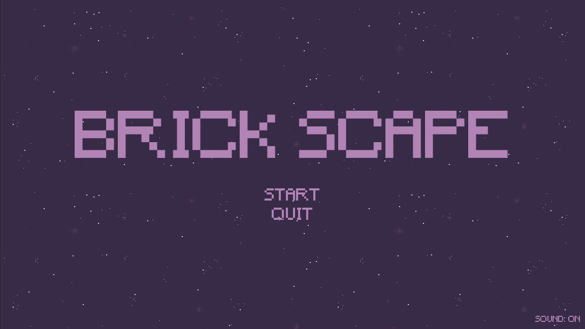
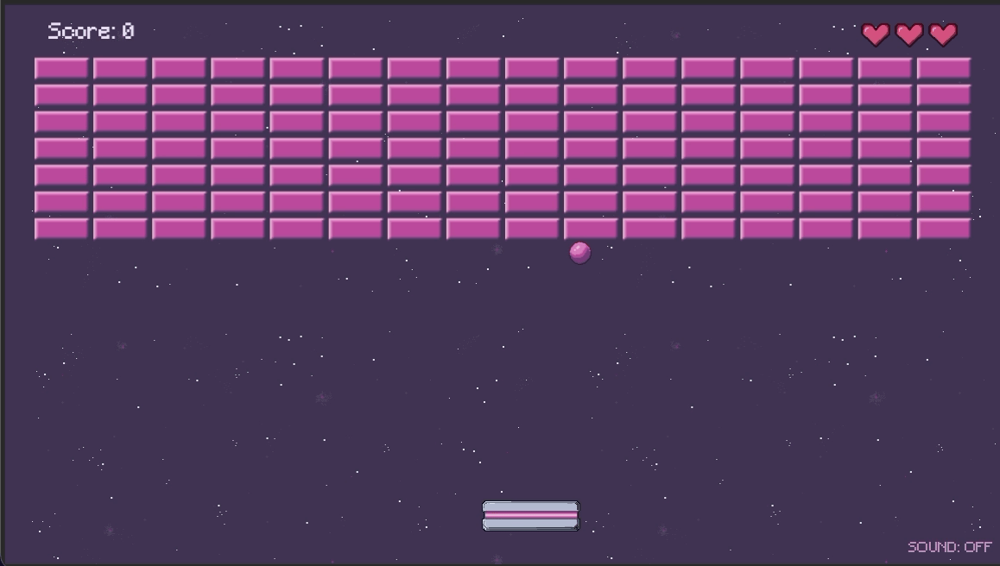

# Brick Scape
A nostalgic 2D brick pong style game. Break all the bricks by bouncing the ball on the paddle.  

<p>
	
	
</p>

## Features  
- 112 bricks to clear (7 rows × 16 columns)  
- Paddle bounce angle depends on where the ball hits the paddle  
- Score tracking and 3 lives, shown as hearts  
- Victory screen with fireworks  
- Retro arcade style music and sound effects, with a sound on/off toggle  
- Custom pixel art made in Aseprite

## Controls  
| Action            | Input         |
| ----------------- | ------------- |
| Move paddle left  | ← Left arrow  |
| Move paddle right | → Right arrow |
| Menus             | Mouse or Tab  |
| Sound Toggle      | Mouse         |
  
## Project Structure  
```  
autoload/     Global singletons (EventBus, GameManager, SceneManager, SoundManager…)  
common/       Shared code such as the generic NodePool  
resources/    Custom resources (SoundLibrary)  
scenes/       Game scenes and their scripts (ball, brick, paddle, hud, levels…)  
assets/       Art, audio and fonts  
```  
  
## Tools  
- Godot with C#  
- Aseprite

## Credits  
- **Font:** [Minecraft](https://www.dafont.com/minecraft.font)  by Craftron Gaming
- All audio is royalty free from [Pixabay](https://pixabay.com/service/license-summary/)
- **Music:** [Neon Gaming](https://pixabay.com/music/synthwave-neon-gaming-128925/) by dopestuff
- **Sound effects:** 
	- [Click Button](https://pixabay.com/sound-effects/film-special-effects-click-button-140881/) by Universfield
	- [Minimalist Button Hover](https://pixabay.com/sound-effects/film-special-effects-minimalist-button-hover-sound-effect-399749/) by Lesiakower
	- [Game Over](https://pixabay.com/sound-effects/technology-game-over-retro-8bit-sfx-499656/) by DRAGON-STUDIO
	- [Victory Bell Success Fanfare](https://pixabay.com/sound-effects/musical-victory-bell-success-fanfare-576275/) by Emand_Edroff
	- [Arcade FX](https://pixabay.com/sound-effects/film-special-effects-arcade-fx-288597/) by lucadialessandro
	- [Metal Slam 2](https://pixabay.com/sound-effects/film-special-effects-metal-slam-2-189784/) by floraphonic
	- [ballhit](https://pixabay.com/sound-effects/film-special-effects-ballhit-352569/) by u_p2u1nij0ok
	- [small explosion](https://pixabay.com/sound-effects/film-special-effects-small-explosion-103779/) by bevibeldesign (Freesound)
- Art: [alishcodes](https://github.com/alishcodes)  
